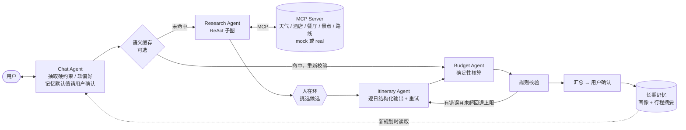

# LangGraph Trip Planner

[](https://github.com/linlinlin12138/langgraph-trip-planner/actions/workflows/ci.yml)

**一句话**：基于 LangGraph 的多 Agent 旅行规划系统。Research 通过 MCP 用 ReAct 检索信息，Research 之后由用户挑选候选；行程用结构化输出逐日生成，规则校验不通过就回退重排；有长期记忆；带一套完整的评测体系。没有 API key 也能用 mock 模式一条命令跑通。

> 📌 **关于数字**：本 README 里的结果**全部来自 mock 模式**（规则模拟的模型），只能证明流程和评测体系能正确运行，**不代表任何真实模型的规划质量**。真实模型（Gemini）的评测还没跑，跑完后会补在下面。

## 架构



完整的图结构、各节点职责和每个设计决策见 [docs/DESIGN.md](docs/DESIGN.md)。

## 功能

| 面试高频话题 | 本项目里的实现 | 位置 |
|---|---|---|
| 多 Agent 编排 | `StateGraph`；State 按写入节点分组并用 reducer 累积；条件边回退且有次数上限；预算不可行时直接说明 | `graph/` |
| Human-in-the-loop | 三处 `interrupt()`：追问、挑选候选、确认；`SqliteSaver` 按 thread_id 持久化，重启进程后可恢复 | `graph/nodes/`、`runtime.py` |
| ReAct / 工具调用 | Research 子图自定义 tools 节点：参数校验错误作为 observation 返回、重复调用检测、每类工具最多 3 轮、并行调用 | `graph/nodes/research.py` |
| MCP | 低层 Server 公开 Pydantic 生成的 schema；Agent 通过 MCP Client 发现工具；stdio 或进程内两种方式 | `tools/mcp_*.py` |
| 结构化输出 | 原生 json_schema 优先，失败后清洗、解析、校验，带具体错误重试 3 次，仍失败则跳过并标记 | `llm/structured.py` |
| 手写 ReAct | 只用 SDK 的 ReAct 循环：重试、重复调用检测、轮数上限、错误作为 observation 返回；14 条验收测试；与 LangGraph 版的对比脚本 | `react_from_scratch/` |
| 长期记忆 | 固定字段的画像（以新为准，记录时间和原话依据），加最多 10 条行程摘要；只记用户原话里出现的偏好；“像上次那样” | `memory/` |
| 可观测性 | 回调式 tracer：每次 LLM 调用的 token、耗时、模型，工具调用，重试；业务代码零埋点 | `observability/` |
| 评测 | 200 条样本（3 档难度，含不可行样本），按完整目录和标准答案重新判定；四类指标；baseline 与 3 组消融；记忆消融；LLM-as-Judge 及权重校准 | `evals/`、[docs/EVAL.md](docs/EVAL.md) |
| 成本与延迟 | 每次运行统计 token、费用（只用确认过的单价）、P95 耗时和各节点耗时；可选的语义缓存 | `observability/pricing.py`、`cache/` |
| 模型层 | 统一的 `BaseChatModel` 接口，覆盖 OpenAI、Anthropic、Gemini 和 mock，环境变量切换 | `llm/factory.py` |

## 快速开始（mock 模式，无需任何 key）

需要 Python 3.11+ 和 [uv](https://docs.astral.sh/uv/)。

```bash
git clone https://github.com/linlinlin12138/langgraph-trip-planner && cd langgraph-trip-planner
```

```bash
uv sync --all-extras
```

```bash
make demo
```

其他常用命令：

```bash
make check                                      # ruff + mypy(strict) + pytest
```

```bash
uv run python -m trip_agents.cli --auto "我和女朋友11月20日去杭州玩3天，预算6000，不吃辣，一定要去灵隐寺"
```

```bash
make eval ARGS="--split dev --repeats 3"        # 完整评测 → evals/runs/<name>/report.md
```

Judge 想换别家模型（比如生成用 Gemini、打分用 GPT）时，先用 `--no-judge` 生成，再单独打分。每条记录都保存了完整行程，换 Judge 不需要重新生成：

```bash
make eval ARGS="--split dev --provider gemini --no-judge --name gemini_dev"
```

```bash
make eval-rejudge RUN=evals/results/gemini_dev ARGS="--judge-provider openai --judge-model <模型名>"
```

真实模型的运行结果写到 `evals/results/<name>/` 并提交进 git（生成要花钱，换 Judge 也要用到保存的行程）；mock 运行写到 `evals/runs/`，不进 git。

使用真实模型时，复制 `.env.example` 为 `.env`，设置 `LLM_PROVIDER=gemini` 和 `GOOGLE_API_KEY`，然后先运行连通性检查和费用估算：

```bash
make check-provider ARGS="--provider gemini --list-models"
```

```bash
make check-provider ARGS="--provider gemini --samples 5"
```

Gemini 默认模型是 `gemini-3.8-flash`（`gemini-2.5-flash` 对新 key 已返回 404）。Gemini 3+ 可用 `LLM_THINKING_LEVEL=low` 减少推理 token；`GEMINI_API_KEY` 也可以代替 `GOOGLE_API_KEY`。检查脚本遇到模型不存在、key 无效、额度或预付费余额不足时，会输出一行原因和处理建议。

## 30 秒演示脚本

| 时间 | 操作 | 要讲的点 |
|---|---|---|
| 0–5s | 运行 `make demo`，侧栏勾选“首版行程注入时间冲突”并点“开始新规划”，再点击示例“我和女朋友…杭州…灵隐寺” | 左边是对话，右边轨迹面板实时显示节点、LLM 调用、token |
| 5–12s | 中间栏出现候选的酒店、景点、餐厅，去掉一个景点后提交 | **Research 之后的人在环**：候选全部来自工具结果；状态存进 SQLite，可以中断后恢复 |
| 12–20s | 右侧显示“第 1 轮校验：1 个错误 → 回退重排；第 2 轮：通过” | **规则校验 + 条件边回退**，只重排出问题的那一天；结构化输出失败会带错误重试 |
| 20–25s | 点击“确认行程”，记忆面板出现“饮食禁忌：不吃辣 / 同行人：女朋友 …” | 只记录用户原话里能找到依据的偏好 |
| 25–30s | 点击“开始新规划”，输入“1月10日去北京玩2天”，点“✅ 沿用这些偏好” | **长期记忆**：只填用户这次没说的字段，并请用户确认 |

可选加演：
- **语义缓存**：侧栏打开“语义缓存”，确认一个行程；再点“开始新规划”，把同一个请求换种说法发一次。界面会显示“语义缓存命中”，跳过检索和候选挑选，缓存的行程会重新核算和校验。
- **中断恢复**：CLI 运行到候选挑选时退出，再用 `uv run python -m trip_agents.cli --thread <id>` 接着跑。

## 评测结果

> 以下全部是 **mock 模式**：模型和 Judge 都是规则模拟的，dev 集 60 条，每组跑 3 次，seed=42，commit `b4f1b09`，2026-11-05（新目录：真实店名、每城 45 个景点；hard 样本预算为最低可行花费的 1.1–1.6 倍）。mock 是确定性的，所以标准差为 0。这些数字只证明评测体系能正确运行，**不能当作模型能力的结论**。完整报告见 [`docs/eval/mock_dev_latest.md`](docs/eval/mock_dev_latest.md)。

| 指标 | full | 去掉回退 | 去掉检索 | baseline（单次生成） |
|---|---|---|---|---|
| 硬约束通过率（可行样本） | 96.5% | 71.9% | 0.0% | 1.8% |
| 其中 hard 样本 | 86.7% | 0.0% | 0.0% | 0.0% |
| 不可行样本识别率 / 可行样本误报率 | 100% / 1.8% | 100% / 1.8% | 0% / 0% | n/a |
| Judge 加权总分（mock 启发式打分） | 83.7 | 84.5 | 66.1 | 68.1 |
| 工具召回率 | 100% | 100% | n/a | n/a |
| 平均 LLM 调用次数 | 9.00 | 7.73 | 6.83 | 1.00 |
| 平均 token（mock 按字符估算） | 15760 | 12944 | 4445 | 838 |

hard 样本的预算很紧，去掉回退后全部超预算，这是回退重排的主要价值所在。`full` 剩下的 2 条失败也是超预算：预算只有最低可行花费的 1.09 和 1.23 倍，重排两次仍没压进预算，其中 1 条被误判为不可行。

**记忆消融**（mock，30 个两次会话场景，每组跑 1 次，commit `b4f1b09`，[报告](docs/eval/mock_memory.md)）：有记忆时，“只说城市日期”“明确修改偏好”“像上次那样”三类场景，第二次会话的字段都 100% 正确；没有记忆时，自动模式下缺信息无法直接规划（实际使用中会转为追问用户）。mock 写入和读取偏好用的是同一套规则，所以这个结果只验证逻辑。

**手写 ReAct vs LangGraph**（mock，dev 集抽 20 条，[报告](docs/eval/mock_react_compare.md)）：两边用同一套检索策略，检索成功率、工具精确率和召回率、步数完全一致，说明两种实现的行为等价。代码量上，手写循环 92 个逻辑行，LangGraph 子图 65 行（不含框架本身）。

**这套评测在开发中实际发现过问题**（以下两条在旧目录上测得）：修复前，`full` 的失败全部是超预算，原因是“要高档酒店但预算有限”时只检索了这一档的酒店。修复后，可行样本的硬约束通过率从 84.2% 升到 100%，误报率从 7.0% 降到 0%（mock，dev 集，[前后对比](docs/eval/mock_dev_compare.md)，分析见 DESIGN §8）。

**真实模型（Gemini）**：尚未运行。

## 设计决策摘要

详细的“问题 → 方案 → 替代方案 → 取舍”见 [docs/DESIGN.md](docs/DESIGN.md)。

- **为什么多 Agent**：每一步都能单独测试、替换和评测；编排用确定性的图，模型只负责节点内的判断，代价是更多的调用次数和 token。
- **为什么选 LangGraph**：checkpoint、interrupt/resume、子图和回调开箱即用；对照组是 `react_from_scratch/`。
- **为什么中断点在 Research 之后**：这时信息最多，但还没开始花规划成本；用户的选择会和检索结果对照清洗。
- **为什么用 Pydantic 加重试**：原生结构化输出优先，并有退路；局部错误（引用、日期）在重试里修，全局约束交给图的回退。
- **为什么逐日生成**：一天是天然的“跳过并标记”单位，回退时也只重排出问题的那几天。
- **为什么 Budget 由代码计算**：LLM 不擅长做加法；而且如果校验本身算错了，整个校验就没有意义。
- **为什么记忆分成画像和摘要**：画像字段固定，便于展示、处理冲突和评测；摘要用来支持“像上次那样”；只记用户原话里有依据的偏好。
- **为什么不信任系统的自我报告**：评测时按完整目录和标准答案重新判定，抽取错误和编造的实体也会被计入。
- **语义缓存为什么这样设计**：全部硬约束做精确过滤，相似度只比较软偏好；实测发现直接比较原始文本时，换个说法的相似度反而低于偏好不同的请求。

## 项目结构

```
src/trip_agents/
  graph/            StateGraph、State、各节点（chat / research / human_select / itinerary / budget / validate / finalize / cache）
  llm/              模型工厂、结构化输出管线、mock 模型（支持故障注入）
  tools/            参数 schema、mock 与 real 后端、MCP server 和 client
  memory/           画像和摘要的 schema、合并规则、基于 Store 的读写
  observability/    回调式 tracer、单价表
  evals/            数据集生成、真值评判、Judge、指标、运行器、报告、记忆评测、权重校准
  cache/            语义缓存
react_from_scratch/ 不用框架的 ReAct 循环、三家 SDK 客户端、测试、对比脚本
app/                Streamlit demo
evals/datasets/     dev.jsonl / test.jsonl（seed=42 生成）
docs/               DESIGN.md、EVAL.md、eval/（各次评测报告）
data/mock/          5 个城市的固定目录：名称和坐标来自 Overture Maps / Wikidata，价格、时间、标签为规则估算（见 ATTRIBUTION.md）
data/sources/       抽取的开放数据候选（scripts/fetch_catalog_sources.py 生成，build_mock_data.py 的输入）
```

## 配置

所有配置都可以用环境变量或 `.env` 设置，见 [`.env.example`](.env.example)。常用的几项：

- `LLM_PROVIDER`：`mock`、`openai`、`anthropic` 或 `gemini`
- `LLM_MODEL`：模型名（留空用各家默认，Gemini 为 `gemini-3.8-flash`）
- `LLM_THINKING_LEVEL` / `LLM_THINKING_BUDGET`：Gemini 3+ / 2.5 的推理开销
- `TOOL_BACKEND`：`mock` 或 `real`
- `TOOL_TRANSPORT`：`mcp` 或 `local`
- `MAX_REVISIONS`：回退次数上限
- `SEMANTIC_CACHE`：是否启用语义缓存
- `PRICING_OVERRIDES`：模型单价。**不内置任何真实单价**，请对照官方价格页填写

## 里程碑

- [x] M1：图编排、4 个 Agent、mock 工具、三处中断、SQLite 恢复、最简 demo
- [x] M2：轨迹记录、200 条评测集、指标、baseline 与消融、报告与对比
- [x] M3：MCP 工具层、real 后端、长期记忆、手写 ReAct 脚手架与对比、记忆消融
- [x] M4：README、DESIGN.md、demo 打磨、语义缓存
- [ ] 真实模型（Gemini）评测：dev 集 → 确认费用 → test 集
- [x] 手写 ReAct 循环（`react_from_scratch/loop.py`）与 LangGraph 版对比（mock）
