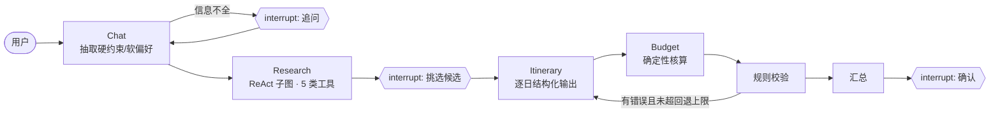

# Trip Agents

基于 LangGraph 的多 Agent 旅行规划系统：Chat 澄清需求 → Research（ReAct 工具调用）→ 用户挑选候选（Human-in-the-loop）→ Itinerary 逐日规划 → Budget 核算 → 规则校验不通过则回退重排。

> 🚧 开发中（M3 完成）。完整文档和设计说明会在 M4 补齐。



## 快速开始（mock 模式，无需任何 API key）

```bash
uv sync --all-extras
```

```bash
make demo        # Streamlit 界面
```

```bash
uv run python -m trip_agents.cli --auto "我和女朋友11月20日去杭州玩3天，预算6000，不吃辣，一定要去灵隐寺" --faults itinerary_overlap_once
```

```bash
make check       # ruff + mypy + pytest
```

```bash
make eval ARGS="--split dev --repeats 3"   # 评测：full / 去回退 / 去检索 / baseline，输出 Markdown 报告
```

评测方法见 [docs/EVAL.md](docs/EVAL.md)。目前只有 mock 模式的结果（只验证流程，不代表模型质量）：[修复前](docs/eval/mock_dev_before_fix.md) · [修复后](docs/eval/mock_dev_after_fix.md) · [对比](docs/eval/mock_dev_compare.md)。

Mock 模式下，模型是一个规则模拟的 `BaseChatModel`，工具读取 `data/mock/` 中的固定数据（景点为真实名称、价格和坐标为近似值；酒店和餐厅为虚构）。**mock 模式只用于验证流程，不代表规划质量。**

## 里程碑

- [x] M1：State、4 个 Agent、mock 工具、LangGraph 编排（条件边回退 + 3 处 interrupt）、SQLite 中断恢复、最简 demo
- [x] M2：轨迹记录（回调，不侵入业务代码）、200 条评测集、4 类指标、baseline 与消融、评测报告与对比
- [x] M3：MCP 工具层（Research 通过 MCP Client 发现和调用工具）、real 后端（Open-Meteo 天气 + OSRM 路线）、长期记忆（画像 + 历史摘要，SqliteStore）、手写 ReAct 脚手架与对比脚本
- [ ] M4：README / DESIGN.md、demo 打磨、可选 Semantic Cache
