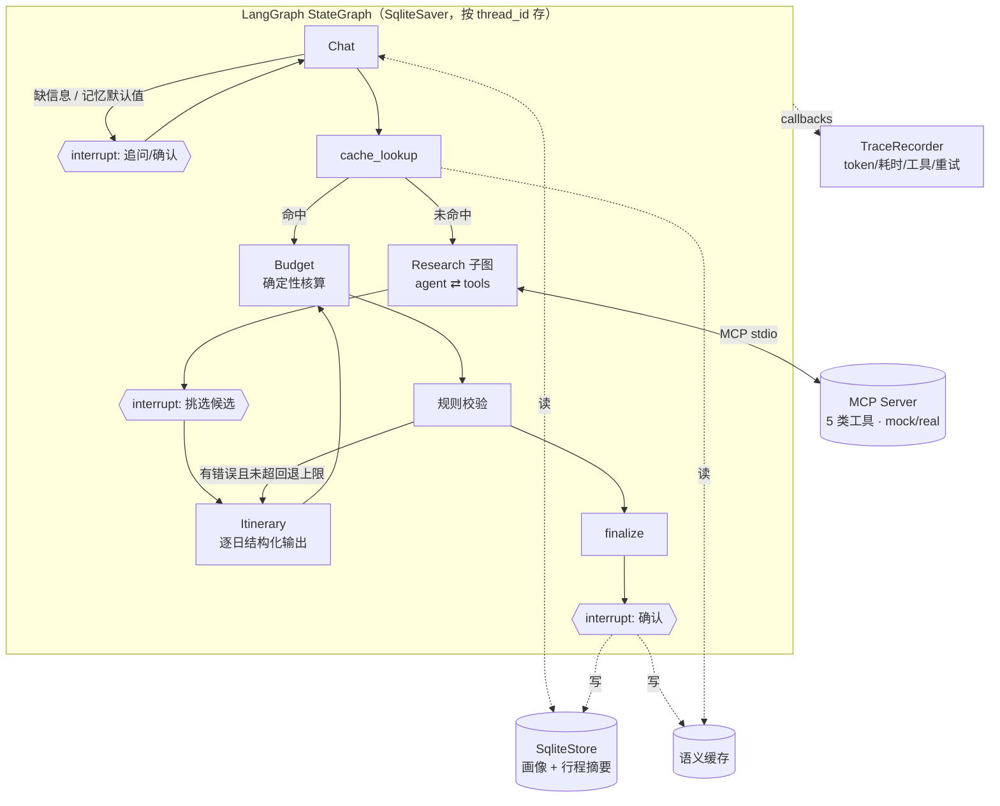

# 设计说明

每个关键设计都按 **问题 → 方案 → 考虑过的替代方案 → 取舍** 来写。文中引用的数字都来自仓库里实际运行的结果，并注明了来源。目前**只有 mock 模式的结果**，只能说明逻辑是对的，不代表模型质量。

## 0. 总览

---

## 1. 为什么拆成多 Agent

**问题**：一次 LLM 调用要同时完成理解需求、查资料、排行程、算钱、自查，任何一步出错都只能整体重来，也说不清是哪一步错了。

**方案**：按职责拆成 Chat、Research、Itinerary、Budget 四个节点，再加上规则校验。每个节点的输入输出都是结构化的 State 字段，一个节点只写自己那一组字段。

**替代方案**
- 单 Agent 一次生成：这就是评测里的 `baseline_catalog`（给它和 full 相同的完整目录，一次生成，不校验不回退）。
- 单 Agent 加工具：一个 ReAct 循环从头做到尾。
- 群聊式多 Agent，比如 AutoGen 的 GroupChat：由 Agent 之间自由对话来协作。

**取舍**
- 拆分之后，每一步都能单独测试、单独替换模型，也能单独评测：抽取准确率、工具召回率、回退次数都是分节点统计的。
- 代价是调用次数和 token 更多。mock 下 dev 集上 `full` 平均 8.2 次 LLM 调用、约 13.9k token，`baseline_catalog` 是 1 次调用、约 9.1k token（大部分是目录本身）（[mock 报告](eval/mock_dev_latest.md)；mock 的 token 是按字符数估算的）。
- 没选群聊式，是因为旅行规划的流程基本固定，不需要 Agent 之间协商。自由对话只会增加不确定性和 token。
- 编排用的是**确定性的图**，模型只负责每个节点内部的判断。

## 2. 为什么用 LangGraph

**问题**：需要条件边（校验失败就回退）、人在环中断、中断后跨进程恢复，还要能观测每一步。

**方案**：用 LangGraph `StateGraph`，节点内调用 `interrupt()`，持久化用 `SqliteSaver`，长期记忆用 `SqliteStore`。

**替代方案**
- 手写状态机：`react_from_scratch/` 就是为了对比这条路线。
- LangChain AgentExecutor：已经不再推荐，而且不支持图结构。
- CrewAI：角色抽象很方便，但对控制流和持久化的掌控更弱。
- Temporal 这类工作流引擎：太重。

**取舍**
- LangGraph 自带 checkpoint、interrupt/resume、子图、回调，这些自己写也能写，但都是样板代码。
- 代价是要遵守它的约定，比如节点恢复后会从头重跑。所以凡是带 interrupt 的节点，都只做中断这一件事，不在里面调 LLM，避免恢复时重复调用。
- 另一个代价是 Pydantic 状态反序列化需要显式白名单：新版默认拒绝未注册的类型，我们在 `checkpoint_serializer()` 里显式放行了自己的类型。

## 3. State 设计

**问题**：多个节点共享同一份状态，有的字段要累积（消息、工具调用记录），有的只要最新值（本轮校验问题）。

**方案**：`TripState` 用 TypedDict，里面放 Pydantic 子模型，字段按写入节点分组。
- 需要累积的字段用 reducer：`messages` 用 `add_messages`，`tool_calls`、`skipped_items`、`issue_history`、`adjustments` 用 `operator.add`。
- 只要最新值的字段直接覆盖，比如 `issues` 只保存最新一轮，用来决定条件边怎么走。

**替代方案**
- 整个 State 做成一个 Pydantic 模型：校验更严格，但每次部分更新都要构造完整对象。
- 全部用 dict：没有类型约束。

**取舍**
- TypedDict 让局部更新很自然，Pydantic 子模型又保证了领域对象本身的约束。
- 一个节点只写自己那一组字段是约定，不是框架强制的，靠代码评审维持。

## 4. 中断点为什么放在 Research 之后

**问题**：在哪里让人介入，收益最大、打扰最少？

**方案**：一共有三处中断。
1. **信息不全或要沿用记忆时追问**：问题是确定性生成的，不调用 LLM。
2. **Research 之后挑选候选**：这是主要的中断点。
3. **最终确认**：确认之后才写记忆和缓存。

中断时把候选和默认选择一起放进 payload 传给前端。用户的返回值会和检索结果对照清洗，界面无法塞进系统没见过的 id。

**替代方案**
- Itinerary 之后再审行程：用户要看完整行程，成本高，改动后还得重排。
- Chat 之后确认需求：信息太少，用户没什么可选。
- 用 `interrupt_before` 做静态中断：没法把候选作为 payload 传出去。

**取舍**
- Research 之后是信息最多、但还没花规划成本的时间点。用户在这里排除自己不想去的地方，比事后改行程省得多。
- 评测模式下 `human_in_loop=False`，自动使用默认选择，让同一张图既能交互也能批量跑。

## 5. Research：ReAct 子图，以及为什么自己写 tools 节点

**问题**：检索需要多轮（结果为空要放宽条件，参数错了要改），同时要防止死循环、重复调用和编造信息。

**方案**：Research 做成 agent ⇄ tools 的子图。tools 节点是自己写的，实现了三条策略：
- 参数校验：失败时把错误作为 observation 返回给模型；
- **重复调用检测**：同名同参数且之前成功过的调用，直接返回缓存结果并标记；
- **每类工具最多 3 轮**，外加最大步数限制。

最终的候选列表 `ResearchBundle` **由工具返回结果组装**，不使用模型写的总结。

**替代方案**：`create_react_agent` 和预置的 `ToolNode`。它们用起来最省事，但不支持这三条策略，而且是黑盒。

**取舍**：子图大约 65 个逻辑行（`make compare-react` 统计）。好处是行为完全可控、能逐条测试。“只用工具结果组装候选”从结构上杜绝了候选列表里出现编造的酒店，这是候选能放心交给用户挑选的前提。

## 6. 工具层：MCP

**问题**：工具要能被不同的 Agent 实现（LangGraph 版、手写版）复用，后端还要能在 mock 和 real 之间切换。

**方案**
- 用 MCP **低层** `Server`。`list_tools` 公开的就是我们 Pydantic 输入模型生成的 JSON Schema；`call_tool` 统一走 `execute_tool`，参数错误返回 `is_error` 结果，而不是协议错误。
- Research 只通过 `list_tools` 发现工具，不导入任何工具代码。
- 图是同步的，MCP client 是异步的。`McpToolExecutor` 在后台线程里持有一个事件循环，用 `run_coroutine_threadsafe` 桥接。
- 用 `TOOL_TRANSPORT` 切换 `mcp` 或 `local`。

**替代方案**
- 直接用 function calling，不走 MCP：最简单，但工具和 Agent 耦合在一起。
- FastMCP 的装饰器：从函数签名推断 schema，和我们的校验模型可能对不上。
- langchain-mcp-adapters：多一层封装，错误处理不透明。

**取舍**
- 同一套 schema 和校验在三条路径上完全一致，有测试保证 MCP 和本地调用的结果相同、最终行程相同。
- MCP stdio 子进程启动约 1 秒。所以评测默认走 local，demo 走 MCP。
- real 后端目前只接了天气（Open-Meteo）和路线（OSRM）。已用 `scripts/smoke_real_backend.py` 联网实测过一次（2026-11-08，开发用的云端环境）：进程内和 MCP stdio 两种传输共 20 项检查，17 PASS、3 WARN、0 FAIL。3 项 WARN 都在 MCP stdio 那一轮（3 天天气、端到端计划里的天气和路线），原因是 Open-Meteo 返回 429 / 连接超时，不是代码错误；同样的检查在进程内那一轮都通过了。错误情况（超过 16 天的预报、定位不到的地名、给 OSRM 的非法坐标、网络超时、非法参数）都作为 `ERROR:` 观察返回，没有让程序崩溃。实测暴露的局限：遇到 429 不退避重试；Open-Meteo 的地理编码只认城镇，目录外的 POI（如“杭州东站”）定位不到；mock 研究策略在天气失败时会一直重试到轮数上限，因此不会去请求路线。

## 7. 结构化输出：原生优先，清洗、解析、校验，带错误重试

**问题**：模型输出可能不合法：JSON 写坏、字段类型错、日期对不上、引用了不存在的 id。

**方案**（`llm/structured.py`）
1. 先用 provider 原生的 `json_schema` 模式；
2. 原生解析失败时，自己清洗（去掉代码块标记、截取出 JSON 对象、去掉尾逗号）再解析；
3. 两层校验：
   - Pydantic schema 校验：类型、范围、`end > start`；
   - 调用方传入的 `extra_check`：需要上下文才能判断的约束，比如 `day_index` 和日期是否匹配、`ref_id` 是否在候选里；
4. 失败时把**具体错误原文**附在下一轮 prompt 里重试，最多 3 次；
5. 仍然失败就跳过该项，并在 `skipped_items` 里标记。

**为什么逐日生成**
- 一天就是一个天然的“跳过并标记”单位：某一天失败，其余几天照样能返回；
- 回退时可以只重排出问题的那几天；
- 输出越短越不容易出错。

**替代方案**
- 一次生成全部天数：调用少，但一处错就要整体重来。
- 只用 prompt 约束 JSON 格式：不可靠。
- 只用原生结构化输出：provider 不支持或失败时没有退路。

**取舍**
- 逐日生成是 N 次串行调用，延迟更高。可以改成“先分配每天的景点，再并行生成每一天”，但这会多一次规划调用，以后需要时再做。
- 我把“局部校验”和“全局校验”分开了：
  - 引用和日期这类**局部错误**，在结构化输出的重试里就地修正，代价小；
  - 时间冲突、预算、必去景点这类**全局约束**，交给图的回退，因为可能需要跨天调整。

## 8. 规则校验与回退

**问题**：硬约束（天数、时间冲突、开放时间、引用、饮食、必去景点、预算）不能靠 LLM 自觉遵守。

**方案**
- 规则是纯函数，返回结构化的问题列表，并区分 error 和 warning。
- 条件边：有 error 且回退次数小于 `max_revisions`（默认 2）就回到 Itinerary，并且只重排有问题的那几天；全局问题才全部重排。
- 如果预算低于“最低可行花费”，就**不回退**，直接告诉用户预算不足，因为再怎么重排也解决不了。

**替代方案**
- 让 LLM 自查：不可靠，而且它会和生成时犯同样的错。
- 不回退，直接报错：用户体验差。

**取舍：硬约束优先于软偏好。这是 M2 评测发现的问题**
- 修复前，dev 集上 `full` 的失败**全部是超预算**。原因是用户要高档酒店但预算有限时，Research 只检索了这一档的酒店，导致两个后果：
  - 最低可行花费被高估，7% 的可行样本被误判为不可行；
  - 回退只能改每天的行程，换不了酒店。
- 修复：
  - 符合档次的酒店都超出预算上限时，按限价、不限档次补查一次；
  - 回退时允许换成更便宜的酒店，并在最终消息里告诉用户。
- 结果：可行样本的硬约束通过率从 84.2% 提升到 100%，误报率从 7.0% 降到 0%（mock，dev 60 条 × 3 次，[前后对比](eval/mock_dev_compare.md)）。

**超预算先用规则修复，修不好才让模型重排**
- 超预算是全局问题，原本会让模型把每一天都重排一遍。在 Gemini dev 试跑里，一条 5 天的 hard 样本两次整体重排用了 22 次调用、$0.43、约 20 分钟。
- 现在当唯一的错误是超预算时，先按顺序做确定性修复，花费都按目录价格计算（§9）：
  1. 换更便宜的酒店；
  2. 把最贵的几顿饭换成符合饮食限制的便宜餐厅：从检索到的全部餐厅里挑（用户选中的优先，但选中的往往是评分高、价格也高的），同一天不重复，尽量分散到不同的店；
  3. 把非必去的收费景点换成免费或更便宜的景点：必须在原时段营业、行程里还没用过，优先同类别、用户选中的。Gemini dev 全量里剩下的失败大多是门票和酒店占掉了预算，只换餐厅到不了预算线。
- 修复后总价回到预算内就不再调用模型；做不到才走原来的整体重排。改动会写进最终消息告诉用户。
- mock 下 `full` 的硬约束通过率 96.5% → 98.2%（hard 86.7% → 93.3%），平均调用次数 8.75 → 8.20。用 Gemini dev 全量里 full 失败的 12 份已保存行程离线模拟：9 份能被修复到合格。这个估计偏乐观，因为模拟时可选的是整个目录，运行时只能从检索结果里选。

## 9. Budget：金额由代码计算

**问题**：LLM 做几十项加法不可靠。预算核算本身要是错了，规则校验也就失去了意义。

**方案**：住宿、餐饮、门票、交通都由代码逐项相加。LLM 只在超预算时给出可执行的省钱建议。最低可行花费同样由代码计算。

**每一项的价格也由代码决定，不用模型填的 `est_cost`**（`graph/costs.py` 是唯一的计算出口）：
- 景点 = 目录门票 × 人数，餐饮 = 目录人均 × 人数，休息 = 0；交通活动没有关联到具体路线，仍用模型的估价；引用解析不到目录的景点或餐厅（幻觉实体）也用模型估价，这类计划本来就会因 `unknown_ref` 不通过。
- Itinerary 节点每生成一天，就把这一天的 `est_cost` 改写成上面的值，预算、校验、超预算修复、界面展示和 Judge 看到的是同一个数。评测侧 `evaluate_plan` 在解析引用之后、核算预算之前做同样的改写，单次生成的系统也走这条路。
- 模型原始估价只用来审计：运行时记在 State 的 `model_costs`（不改 `Activity` 的 schema，模型看到的结构不变），汇总进 `BudgetReport` 和 `RunRecord`，报告里给出估价偏差、少报超过 10% 的计划数，以及如果相信模型估价，有多少计划的超预算结论会翻转。

**为什么**：原先餐饮、门票直接加总模型填的 `est_cost`，没有规则核对它和目录价格是否一致。模型把人均 300 的餐厅写成 50，系统自检和评测的预算检查都会通过；回退时也可能靠压低估价“修好”超预算，而不是真的换便宜的选择。用已保存的 Gemini dev 全量行程重新判定：`full` 有 5 份计划（全是 hard 样本，其中 3 份是在回退之后）只是因为估价偏低才通过了预算检查，hard 样本的通过率从 53.3% 降到 20.0%。偏低的原因有把人均当总价、直接压低价格，也有人数抽取错误（“我和朋友”被理解成 1 人）。

**取舍**：Prompt 第 6 条（让模型自己算花费）保留不改，避免改变模型行为、影响和已有试跑的可比性；它现在只影响模型规划时的预算意识，不再影响判定。代码保证算术和单价一致，不保证目录价格真实（目录价格本身是规则估算的，见 `data/mock/ATTRIBUTION.md`）。

## 10. 长期记忆：为什么分成画像和摘要

**问题**：既要记住“我不吃辣”这类长期偏好，也要能回答“像上次那样”。同时绝不能把模型推测出来的东西当成用户偏好。

**方案**（`memory/`）
- **画像**固定 5 个字段：饮食禁忌、住宿档次、节奏、预算习惯（人均每天）、同行人。每个字段只保存一个当前值，附带时间、原话依据和最多 5 条历史。冲突时以新的为准，旧值进历史。
- **行程摘要**每次确认生成一条，最多保留 10 条，超出时淘汰最旧的。摘要**由最终 State 确定性生成**，不调用 LLM。
- **只记用户明确说过的话**：模型提取偏好时必须给出原话依据，`merge_profile` 会检查这段原话是否真的出现在用户消息里，找不到就丢弃。
- **读取时**只填用户这次没说的字段，优先级是：本次明确说的 > “像上次那样”引用的那次行程 > 画像。所有沿用的值都会列出来请用户确认。用户可以说“这次什么都吃”，覆盖记忆里的饮食限制。
- **写入时机**：用户确认行程之后。没被确认的方案不代表用户偏好。

**替代方案**
- 把全部对话存进向量库，用时检索：召回内容不可控，也不知道什么时候该忘。
- 只存自由文本的摘要：读取时还得再让 LLM 解读一遍，冲突难以处理。
- 每轮对话都写记忆：会把临时的说法当成长期偏好。

**取舍**
- 画像字段固定，就容易展示、编辑、做冲突处理，也容易评测；代价是表达能力有限，固定字段之外的偏好只能放进行程摘要。
- 历史行程检索用的是“按目的地关键词匹配，否则取最近一次”，**不用向量检索**：每个用户最多 10 条短记录，按元数据精确匹配比向量检索更便宜，结果也更可预期。
- 记忆消融（mock，30 个两次会话场景，[报告](eval/mock_memory.md)）：
  - 有记忆时三类场景都 100% 正确，无记忆时自动模式下都无法直接规划；
  - mock 写入和读取偏好用的是同一套规则，所以 100% 是由构造决定的，只能验证逻辑。抽取质量要等真实模型来测。

## 11. 可观测性：用回调采集，不侵入业务代码

**问题**：要记录每次模型调用（token、耗时、模型名）、每次工具调用、每次重试，但不想在每个节点里埋点。

**方案**（`observability/tracer.py`）：`TraceRecorder` 是一个 LangChain `BaseCallbackHandler`，各类信息的来源是：
- **模型调用**：`on_chat_model_start` 和 `on_llm_end`，token 取自 `usage_metadata`；
- **节点耗时**：`on_chain_start` 和 `on_chain_end`，判断条件是 run 的名字等于 `langgraph_node`；子图节点通过 `checkpoint_ns` 找到父节点；
- **工具调用**：从 Research 的 tools 节点的输出里读取；
- **结构化输出的重试**：`structured.py` 发出 custom event。

使用时只需在调用时传入 `{"callbacks": [tracer]}`，评测、UI、检查脚本用的都是同一个 tracer。

**替代方案**
- LangSmith 或 Langfuse：功能更全，但需要外部服务。tracer 的数据结构可以直接导出给它们。
- OpenTelemetry：更通用，接入成本更高。

**取舍**：依赖 LangChain 回调的语义，比如 metadata 里的字段名；框架升级时要回归测试。`tests/test_evals.py::test_tracer_*` 校验了“记录的 LLM 调用数等于模型实际被调用的次数”。

## 12. 评测设计

**问题**：Agent 的输出是开放的，很难打分；自建的数据集又容易出现“自己出题、自己判卷”。

**方案**（详见 [EVAL.md](EVAL.md)）
1. **先采样结构化约束，再改写成自然语言**：约束本身就是标准答案。难度在生成时由约束数量和预算松紧决定，与模型表现无关。不可行样本按全目录的最低可行花费构造。
2. **不信任系统的自我报告**：最终行程会对照**完整城市目录**和**标准答案约束**重新检查，用的是标准答案而不是系统自己的抽取结果，因此抽取错误也会算进去。无法解析的引用记为实体幻觉。
3. 两层评测：
   - 规则校验守住硬约束；
   - LLM Judge 评三个维度（各 0–100），评分说明里给出锚点示例，**加权在代码里做**，并且可以用人工打分校准权重（Spearman 网格搜索）。
4. dev / test 分层划分，test 只用于最终评测。M2、M3 期间的所有修复都只看了 dev 集。
5. 指标覆盖结果、过程、效率、稳定性四类，多次运行报告均值 ± 标准差，耗时报告 P95。

**替代方案**
- 直接用 LLM 生成测试题：答案不可控。
- 只用 Judge 打分：会受模型偏好影响，而且分不清是哪条硬约束没满足。
- 只看人工评测：贵，不可重复。

**取舍**
- 模板改写的口语化程度有限，mock 抽取器能 200/200 完整还原，所以 mock 评测测不出 NLU 能力。等真实模型接入后会改用 LLM 改写，并回抽校验改写有没有丢信息。
- mock 是确定性的，稳定性指标恒为 1。

## 13. Mock 模型

**问题**：没有 API key 也要能跑通 demo、测试、CI 和评测流程，并且能稳定地复现各种错误路径。

**方案**
- `MockChatModel` 是一个真正的 `BaseChatModel`，支持 `bind_tools` 和 `with_structured_output(include_raw=True)`，也会向回调报告 token，和真实模型走同一条代码路径。
- 节点通过 `<context>` JSON 块向模型传递结构化上下文，mock 解析这个块后按规则作答。
- 支持故障注入：`bad_json_once`、`itinerary_overlap_once/always`、`bad_tool_args_once`。

**取舍**：mock 规划器是规则写的，能力有限。**mock 下的评测数字只说明流程正确，不代表任何模型的质量**，所有 mock 报告都标注了这一点。

## 14. 语义缓存（可选，默认关闭）

**问题**：重复或高度相似的请求，不必每次都重新检索、重新规划。

**方案**（`cache/semantic.py`）
1. **精确元数据过滤，覆盖全部硬约束**：城市、日期、天数、人数、饮食、必去景点、500 元一档的预算档位。
2. **相似度只比较软偏好的规范化描述**（兴趣、节奏、住宿、菜系、备注），阈值 0.85。
3. 命中后，缓存的行程会**重新经过 Budget 和规则校验**，有错误就照常回退。
4. 只缓存通过校验并被确认的行程；命中的结果不会再存一遍。
5. 淘汰：先按 TTL 过期，超出容量时按 `log1p(命中次数) − 0.3 × 闲置天数` 删除得分最低的。

**为什么不直接对原始请求文本求相似度**：用离线的 n-gram 哈希嵌入实测，同一个需求换一种说法相似度只有 0.68，而兴趣完全不同的请求反而有 0.86。字面重合度不等于语义。改成规范化描述之后：
- 软偏好相同：1.00；
- 一个兴趣不同：0.65；
- 节奏不同：0.75；
- 住宿档次不同：0.72；
- 多一句备注：0.855，刚好命中。
（用 `HashingEmbedder` 实测，2026-11-04；阈值行为由 `tests/test_cache.py` 固定。）

**为什么硬约束不能交给相似度判断**：“不吃辣”只差三个字，相似度会非常高，但缓存的行程可能完全不满足饮食限制。

**替代方案**：向量数据库，或者只做精确缓存。几百条以内，SQLite 加 JSON 存向量就够了；只做精确缓存的话，措辞一变就命中不了。

**取舍**：命中时会跳过检索和挑选候选这两个人在环的环节，所以默认关闭，在侧栏打开。

## 15. 模型层

**方案**
- 统一使用 LangChain 的 `BaseChatModel`：`get_chat_model(provider, model)` 支持 mock、openai、anthropic、gemini 四种，通过 `LLM_PROVIDER` 和 `LLM_MODEL` 切换。
- 结构化输出统一用 `method="json_schema"`。
- 默认使用各家的小模型，评测时可以分别指定生成模型和 Judge 模型。
- 价格表**不内置任何真实单价**，要在确认官方价格后通过 `PRICING_OVERRIDES` 配置；没配单价的模型，费用显示 n/a。

**替代方案**
- LiteLLM：统一接口更彻底，但和 LangGraph 的回调、结构化输出衔接要多做一层。
- 每家各写一个适配器：`react_from_scratch/client.py` 就是这么做的，作为对照。

## 16. 已知局限与下一步

- **真实模型结果只有一个模型、一种设置**：Gemini 3.8 Flash、推理强度 low，dev 和 test 各跑一次（见 EVAL.md）。每组只跑一次，1–2 条样本的差异不能当作结论；稳定性需要多次运行。
- **可行性判断基于检索子集**：运行时的“最低可行花费”只用检索到的候选计算。子集里没有足够便宜的酒店或餐厅时，最低花费被高估，系统会把可行的请求判为预算不足、不尝试回退。这是 test 集上 full 剩余失败的主因（8 条中 5 条）。
- **记忆合并的两个问题**（真实模型记忆消融发现，主流程冻结，未修复）：饮食限制按字段整体替换，用户新增一项限制时旧的被丢掉（应取并集）；画像把同行人存成自由文本，解析不出时人数默认 1、预算跟着错（应直接存人数，不能确定时追问）。
- **合格计划偏“素”**：两边都合格的样本上，一次生成（拿完整目录）的质量分高约 3 分、景点更多。推测是 full 只能从检索子集里挑，未经实验验证。
- **dev 上的调整有一定过拟合**：full 的 hard 样本 dev 14/15，test 76.5%。
- **交通费用仍用模型估价**：交通活动没有关联到具体路线，代码无法核价。交通在总花费中占比小，但理论上仍可被少报。
- 已保存的 Gemini 结果是用新规则**重新判定**的：评测结论按目录价格，但这些运行当时的回退和超预算修复仍基于模型估价做决策。要得到新规则下的运行时行为，需要重跑。
- **请求文本是模板生成的**：主评测和记忆消融都用模板请求。挑战集（36 条，LLM 改写加人工检查）显示抽取对改写很稳，但俗称（如“国博”）找不到对应景点。
- real 后端只接了两类工具，只做过一次联网冒烟测试（见 §6），对限流没有退避；其余工具仍用固定目录（名称和坐标来自 Overture Maps / Wikidata，价格、营业时间和饮食标签是规则估算的）。
- Itinerary 逐日串行生成，延迟随天数线性增加。
- Judge 权重（丰富度 0.3 / 偏好符合度 0.4 / 合理性 0.3）已由项目作者人工打分校准，结果与默认比例接近，因此沿用默认权重。
- 手写 ReAct 和 LangGraph 版在 mock 下行为一致（同一套检索策略），两者在真实模型上的差异还没测。
